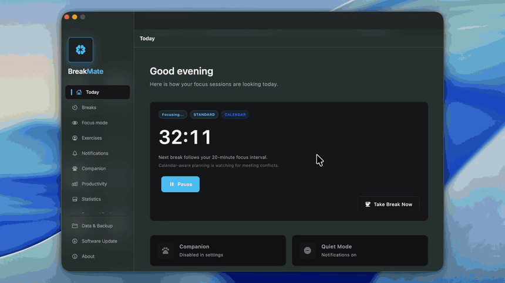
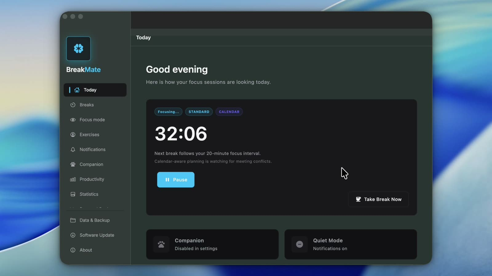
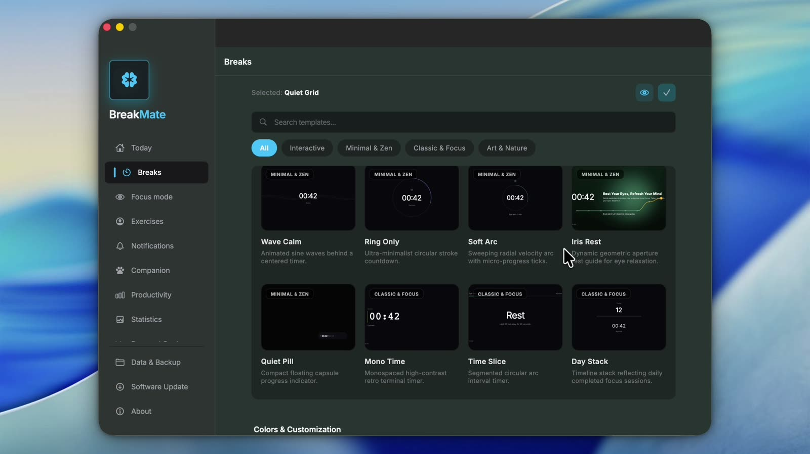
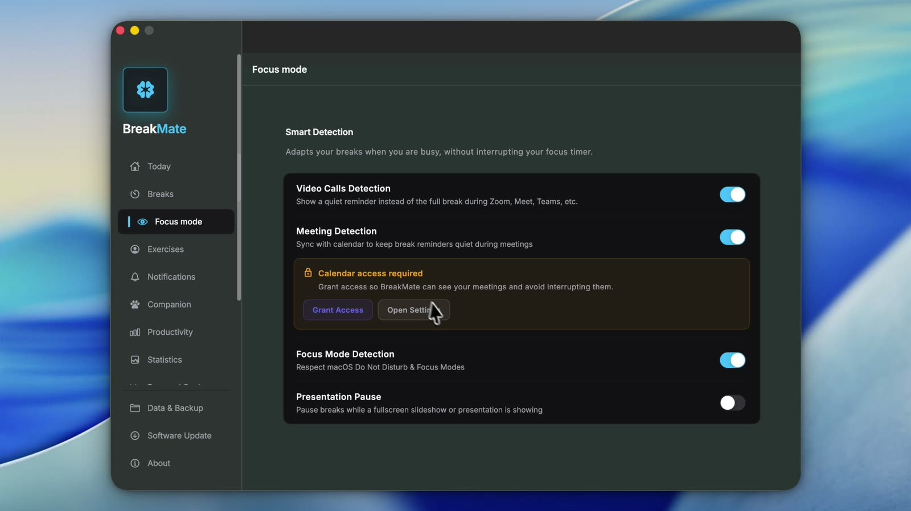
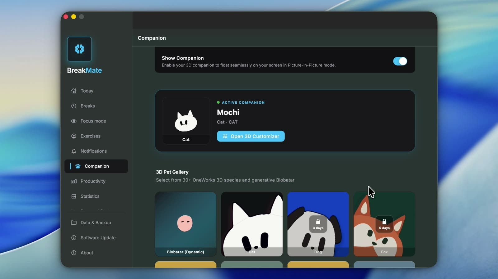
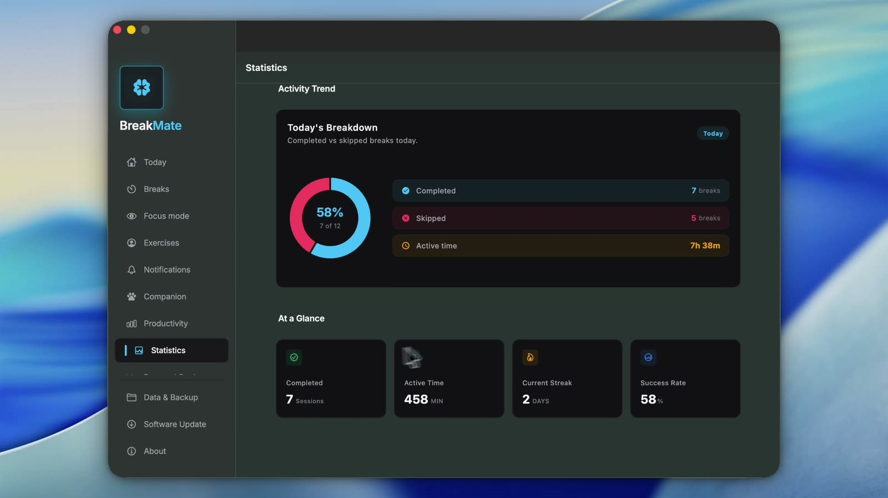
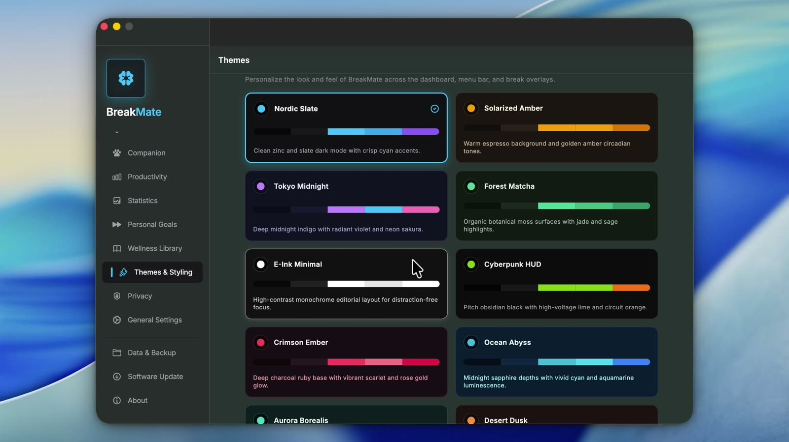
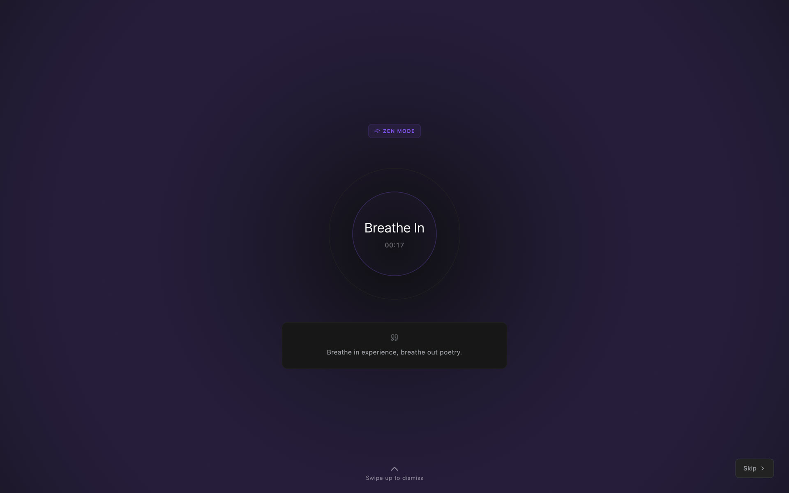

<div align="center">


# BreakMate

**A desktop break-reminder and wellness companion that protects your eyes, posture, and focus — without breaking your flow.**

   

[](https://github.com/bijithpn/standup/releases/latest)
[](#installation)
[](https://flutter.dev)
[](LICENSE)

[Download](https://github.com/bijithpn/standup/releases) · [Features](#features) · [Getting Started](#development-setup) · [Architecture](#architecture) · [Changelog](CHANGELOG.md) · [Author](#author)

<a href="screenshots/walkthrough.mp4"></a>

</div>

---

## Table of Contents

- [Overview](#overview)
- [Screenshots](#screenshots)
- [Features](#features)
- [Installation](#installation)
- [Usage](#usage)
- [Privacy & Data](#privacy--data)
- [Development Setup](#development-setup)
- [Architecture](#architecture)
- [Testing & Quality](#testing--quality)
- [Release Pipeline](#release-pipeline)
- [Project Structure](#project-structure)
- [Contributing](#contributing)
- [Author](#author)
- [Acknowledgements](#acknowledgements)
- [License](#license)

---

## Overview

Long stretches at a screen lead to eye strain, stiff necks, and "tunnel-vision" focus. BreakMate sits in your menu bar / system tray, schedules breaks around the way you actually work, and nudges you at the right moment — never during a meeting or presentation.

| Pillar | What BreakMate does |
| --- | --- |
| **Physical protection** | Eye-rest (20-20-20), stretch, and movement prompts with guided exercises. |
| **Mental clarity** | Pomodoro, Deep Work, Developer, and Health presets to prevent cognitive fatigue. |
| **Context awareness** | Detects meetings, presentations, idle time, and calendar events, and adapts. |
| **Ambient companion** | An animated desktop pet that reflects your state and celebrates streaks. |
| **Insight** | Local-only analytics for breaks, focus, and app usage. |

## Screenshots

<p align="center">
  <a href="screenshots/walkthrough.mp4"></a><br>
  <sub><a href="screenshots/walkthrough.mp4"><b>Watch the 46-second walkthrough</b></a> (MP4)</sub>
</p>

| | |
| --- | --- |
| <br>**Today** — live countdown, next-break reasoning, quiet mode | <br>**Break templates** — searchable gallery with accent colors |
| <br>**Smart detection** — meetings, video calls, presentation pause | <br>**Companion** — 3D species, breeds, and streaks |
| <br>**Statistics** — productivity and wellness scores | <br>**Themes** — 12 curated presets plus auto light/dark |
| <br>**Zen Mode break** — paced breathing circle | <br>**Quiet Pill** — subtle reminder during meetings |

---

## Features

### Health reminders

One **Health reminders** switch turns on five gentle nudges, scheduled around how you actually work rather than on a fixed clock.

| Reminder | Baseline cadence | Counts as done when you… |
| --- | --- | --- |
| **Eye rest** (20-20-20) | every ~20 min | look away for 20 s |
| **Posture** | every ~30 min | step away for 2 min |
| **Stretch** | every ~40 min | step away for 2 min |
| **Hydration** | every ~50 min | step away for 5 min |
| **Stand up** | every ~60 min | step away for 2 min |

- **Workload-aware** — busy days (long hours, constant app switching) remind more often; light days less.
- **Varied, not mechanical** — intervals are jittered ±15% and the reminder shown is a weighted random pick.
- **Real relief counts** — stepping away or finishing a break resets the matching reminders.
- **Never in the way** — deferred during meetings, calls and presentations; spaced at least 4 min apart with an hourly cap; reminders you keep ignoring back off.
- **Shown as a small pill** — a brief, dismissing pill on screen (native window on macOS).

### Break orchestration

- **Short and long breaks** on independent intervals, driven by a precision `TimerEngine`.
- **Break profiles** — one-click presets:

  | Preset | Short break | Long break |
  | --- | --- | --- |
  | Health Mode | every 20 min · 20 s | every 60 min · 1 min |
  | Developer Mode | every 30 min · 30 s | every 90 min · 2 min |
  | Deep Work | every 50 min · 60 s | every 120 min · 3 min |
  | Pomodoro | every 25 min · 5 min | every 100 min · 15 min |

- **Pre-break warning** — a translucent countdown (20 s by default) with a visible timer and skip action, so you can finish your sentence first.
- **Flash notifications** — subtle screen-edge pulses for low-distraction awareness.
- **Strict mode** — prevents skipping; locks the break overlay above other windows.
- **Snooze and skip** from the tray, dashboard, or overlay. The dashboard offers 2-, 5-, and 15-minute snoozes, or snooze until the end of overlapping calendar meetings, with a visible resume time.
- **Weekly working hours** — customize each working day, exclude lunch, and schedule overnight shifts. The dashboard explains schedule pauses and shows the next working time.
- **Reminder intensity presets** — Gentle, Balanced, and Firm bundle warning duration, sound, and display coverage; all three allow skipping breaks.
- **Global hotkey** — `⌘⌥B` (macOS) / `Ctrl+Alt+B` (Windows/Linux) starts a break immediately, or skips the active one.
- **Adaptive scheduling** that learns from how often you skip or postpone breaks.

### Break overlay

- Full-screen overlay with multiple templates (including breathing, eye-sync, and Night Sky), animated posters, and per-template accent colors.
- Context line explaining *why* the break started and what is expected.
- Guided exercises with automatic posture and eye-rest prompts.
- 12 curated theme presets (e.g. Crimson Ember, Ocean Abyss, Aurora Borealis, Desert Dusk, Lavender Mist, Monokai Pro).
- Multi-monitor aware placement.

### Smart detection

- **Meetings** — auto-pauses during calls (Zoom, Teams, Meet, etc.) via native detection and browser URL matching; resumes when the call ends.
- **Calendar-aware scheduling** — reads your calendar (macOS EventKit bridge) and finds the next free gap long enough for a break instead of colliding with meetings.
- **Presentation pause** — defers breaks when a fullscreen slideshow or screen share covers the display; during meetings/presentations only a subtle low-opacity reminder is shown, never the full overlay.
- **Idle detection** — pauses or resets the cycle when you step away; away time can count as a break.
- **Contextual wellness** — suggestions tailored to the active app category (coding → posture, writing → wrist relief, browsing → eye rest, meetings → post-call reset).

### Automatic pause and resume

The work timer pauses when you are away and resumes when you genuinely return. `ActivityMonitor` is the single source of truth; native runners only report events.

| Condition | Source | Pauses timer |
| --- | --- | --- |
| No input for the threshold (default 5 min) | macOS `CGEventSource`, Windows `GetLastInputInfo`, Linux Mutter `IdleMonitor` or XScreenSaver (X11) | yes (setting) |
| Screen lock | macOS `com.apple.screenIsLocked`, Windows `WM_WTSSESSION_CHANGE`, Linux login1 / ScreenSaver signals | yes (setting) |
| Sleep, hibernate, lid close | macOS `NSWorkspace`, Windows `WM_POWERBROADCAST`, Linux login1 `PrepareForSleep` | always |
| Sign-out, fast user switch, RDP disconnect | macOS session resign/active, Windows WTS session events, Linux login1 `Active` | always |

Rules:

- Idle time up to the threshold counts as work and is then discarded, so it is never subtracted twice.
- After sleep or lock the timer stays frozen until every reason has cleared **and** fresh input is seen (idle < 5 s). A wake notification alone never resumes it.
- A manual pause is never resumed automatically. The tick loop never lifts an inactivity pause either; only the monitor does.
- Missed lock/unlock/session events are reconciled by polling `getSessionState` every 5 s (1 s while waiting for input).
- If no idle provider exists the setting is shown as unavailable, a warning is logged, and only sleep/lock events pause the timer. Unlock or wake then counts as the return signal.
- Break in progress: idle does not pause a break. Sleep/lock extend it by the time away, per the existing break policy.
- No keystrokes, mouse positions or window titles are read. No Accessibility permission, event tap or admin rights are needed.

Settings (General > Idle & Inactivity): pause when idle, idle threshold (1-15 min), resume when active, pause when locked. Changes apply immediately.

| Platform | Status |
| --- | --- |
| macOS | Implemented; compiles (dev flavor). Not yet verified by hand across sleep/lock/fast user switching. |
| Windows 10/11 | Implemented, **not built or tested in this environment**. A UAC secure-desktop prompt briefly looks like a lock. |
| Linux X11 | Implemented, **not built or tested**. Idle via Mutter (GNOME) or `libXss.so.1` if installed. |
| Linux Wayland | GNOME: idle via Mutter. KDE and other compositors: no global idle API, reported unavailable; sleep and lock still work. |

Troubleshooting: set the log level to info and look for `[ActivityMonitor]` lines (provider availability, `away +locked`, `ACTIVE -> IDLE`). On Linux install `libxss1` for X11 idle detection on non-GNOME desktops.

Tests: `flutter test test/core/services/activity_monitor_test.dart test/core/services/timer_orchestrator_test.dart`.

### Desktop companion

- Pick a companion from the bundled species and breeds, and give it a name.
- `PetBehaviorBrain` — a weighted-decision engine with personality traits (playfulness, curiosity, sociability), context awareness (cursor proximity, meetings), and a recency penalty to avoid repetitive animation.
- Draggable, resizable **Picture-in-Picture** window; optional **wandering** across the desktop.
- **Scene themes** — selectable environments with parallax skies, ambient lighting, and avatar scene styles.
- Reacts to break/focus streak milestones (3 / 7 / 14 / 30 / 60 / 100 days).
- Low-distraction mode and a resource-saving optimization toggle.

### Analytics & insights

- **Break statistics** with a 365-day GitHub-style heatmap.
- **Productivity & focus** — activity segments, focus time by day, daily focus score, trends, and streaks.
- **App usage tracking** (opt-in) with category daily budgets and over-budget warnings.
- **Break/focus correlation** insights and a **weekly digest** with one-click export.
- **Personal goals** — daily focus targets, break-count targets, weekly consistency and rest days, with gentle recovery copy after missed days.
- **Exercise preferences** — filter guided breaks by seated/standing position, equipment, movement and body areas to avoid. No matching exercise falls back to quiet rest.
- **Weekly observation** — one dated observation in Statistics, with an optional timing proposal when enough data supports it.
- **Optional interruption feedback** — “Bad timing” and “Too frequent” on Today show a proposed adjustment that changes settings only after Apply.

### Menu bar / system tray

- Live countdown in several styles, plus companion, minimal, default, or countdown-only icons.
- Quick actions: start/skip break, 5- and 15-minute snooze, quiet mode, companion toggle, and pause reason.

### Platform & reliability

- Launch at startup, single-instance protection, automatic crash reporting (Sentry, release builds only), and in-app auto-updates via Sparkle on macOS.
- Settings search, per-section reset, and inline dependency warnings. Everyday controls appear first; less frequent general, notification and focus controls expand on demand.
- **Accessibility** — adjustable app text size (100–150%), high contrast, reduced motion, visible keyboard focus and keyboard access to settings tabs. Larger-text and high-contrast full breaks use a simple scrollable view.
- A **permissions and detection health panel** in Smart Detection shows notification/calendar status, current meeting and smart-pause signals, and links to setup and system settings. Permission availability varies by platform.

---

## Installation

Download the latest build from the [**Releases**](https://github.com/bijithpn/standup/releases) page.

| Platform | Package | Notes |
| --- | --- | --- |
| **macOS** 12+ | `.dmg` | Drag to Applications. Updates automatically via Sparkle. |
| **Windows** | Installer (`BreakMate-Setup-<version>`) or `.zip` | Inno Setup installer. Unsigned, so a browser download may trigger SmartScreen; use the one-liner below. |
| **Linux** | `BreakMate-<version>-linux-x64.tar.gz` | Includes a `.desktop` entry (`com.bijith.breakmate.desktop`). |

**macOS first launch** — BreakMate is not notarized by Apple, so a DMG downloaded in a browser may show *"Apple could not verify BreakMate is free of malware"*. Either install with one command (`curl` downloads aren't quarantined, so no warning appears):

```bash
curl -fsSL https://github.com/bijithpn/standup/releases/latest/download/install.sh | bash
```

or, if you already installed the DMG, run `xattr -cr /Applications/BreakMate.app`, or go to **System Settings → Privacy & Security → Open Anyway**. Local builds and in-app Sparkle updates are not affected.

**Linux / Windows one-liners** — per-user installs that skip the browser download:

```bash
curl -fsSL https://github.com/bijithpn/standup/releases/latest/download/install_linux.sh | bash
```

```powershell
irm https://github.com/bijithpn/standup/releases/latest/download/install.ps1 | iex
```

**Homebrew (macOS)** — `brew tap bijithpn/standup https://github.com/bijithpn/standup && brew install --cask breakmate` (the cask removes the quarantine flag for you; `brew uninstall --cask --zap breakmate` also removes app data).

**Uninstall** — run the matching script from the latest release:

```bash
curl -fsSL https://github.com/bijithpn/standup/releases/latest/download/uninstall.sh | bash -s -- --purge   # macOS (--purge also deletes data)
curl -fsSL https://github.com/bijithpn/standup/releases/latest/download/uninstall_linux.sh | bash           # Linux
```

```powershell
irm https://github.com/bijithpn/standup/releases/latest/download/uninstall.ps1 | iex                        # Windows
```

**macOS permissions** — BreakMate may ask for Calendar access (to avoid scheduling breaks over meetings) and Accessibility/Screen-related access for meeting, idle, and app-usage detection. Every feature degrades gracefully if you decline.

---

## Usage

1. Launch BreakMate; onboarding helps you choose a goal, break profile, reminder intensity, and companion. Try an optional 20-second practice break before finishing; the demo does not affect your statistics.
2. The app lives in the menu bar / system tray. Click it for the countdown and quick actions.
3. Open the dashboard to adjust **General, Breaks, Smart detection, Exercises, Notifications, Companion,** and **Statistics**.
4. Press the global hotkey any time to take a break right now.

---

## Privacy & Data

- **Local-first.** Break history, focus data, and app usage are stored on your device (ObjectBox).
- **App usage tracking is opt-in** and can be disabled or wiped at any time from Settings → Privacy.
- A built-in **Privacy Report** lists which signals are detected, what is stored, and which permissions are used.
- Crash reporting (Sentry) runs only in production builds with a configured DSN; the dev flavor does not report.

---

## Development Setup

### Prerequisites

| Tool | Version / notes |
| --- | --- |
| Flutter | `3.41.x` (Dart `^3.10.4`) |
| macOS | Xcode + CocoaPods |
| Windows | Visual Studio 2022 with "Desktop development with C++" |
| Linux | GTK 3 toolchain (`clang`, `cmake`, `ninja-build`, `libgtk-3-dev`) |
| Release tooling (optional) | `create-dmg`, `gh`, Sparkle tools — see [Release Pipeline](#release-pipeline) |

### Run locally

```bash
git clone https://github.com/bijithpn/standup.git
cd standup
flutter pub get

# macOS only
cd macos && pod install && cd ..
```

BreakMate has `dev` and `prod` flavors. macOS uses Xcode flavors; Windows/Linux receive the flavor via `FLUTTER_FLAVOR` because Flutter has no `--flavor` support there.

```bash
# macOS
flutter run -d macos -t lib/main_dev.dart  --flavor dev
flutter run -d macos -t lib/main_prod.dart --flavor prod

# Windows
flutter run -d windows -t lib/main_dev.dart  --dart-define=FLUTTER_FLAVOR=dev
flutter run -d windows -t lib/main_prod.dart --dart-define=FLUTTER_FLAVOR=prod

# Linux
flutter run -d linux -t lib/main_dev.dart --dart-define=FLUTTER_FLAVOR=dev
```

Equivalent launch configurations are in `.vscode/launch.json`.

### Code generation

ObjectBox, Freezed, and JSON models are generated. Re-run after changing annotated models:

```bash
dart run build_runner build --delete-conflicting-outputs
```

### Verify native changes

`flutter analyze` only checks Dart. After touching `macos/`, `windows/`, or `linux/`, do a real build:

```bash
flutter build macos   --debug --flavor dev -t lib/main_dev.dart
flutter build windows --debug -t lib/main_dev.dart --dart-define=FLUTTER_FLAVOR=dev
flutter build linux   --debug -t lib/main_dev.dart --dart-define=FLUTTER_FLAVOR=dev
```

---

## Architecture

BreakMate runs several Flutter engines (via `FlutterEngineGroup`) so heavy secondary UI never blocks the dashboard.

| Isolate / engine | Responsibility |
| --- | --- |
| **Main** | Dashboard, settings, timer engine, statistics, native hooks. |
| **Overlay** (`overlayMain`) | Full-screen break, warning, and reminder overlays. |
| **Companion** (`companionMain`) | Desktop pet and PiP window. |
| **Background polling** | Lightweight activity, meeting, and app-usage sampling. |

- **IPC** — a MethodChannel layer syncs timer state, meeting/sleep state, and interactions across isolates in real time.
- **Native bridges** — Swift (`AppDelegate`, `CompanionWindowManager`, EventKit calendar) on macOS; C++ (`display_bridge`, `companion_window_manager`) on Windows; GTK runner on Linux.
- **Single-instance lock** — a localhost TCP listener (port `10425` for production, `10426` for the dev flavor, so the two can run side by side); a second launch of the same flavor asks the running instance to shut down, with stale-process cleanup.
- **Storage** — unified `StorageService` with migrations, lock-file cleanup, and a mirrored key-value store for critical settings.
- **State & DI** — `provider` + `get_it`, with a dedicated bootstrapper for startup ordering.

---

## Testing & Quality

```bash
dart format --output=none --set-exit-if-changed lib test   # formatting (enforced in CI)
flutter analyze   # static analysis
flutter test      # unit, widget, and property-based tests (glados, mocktail, fake_async)
```

CI (`.github/workflows/cross_platform_ci.yml`) runs on pushes to `dev` and on PRs to `main`/`dev`: format check, analyze, tests, release-readiness checks (required files and the `SPARKLE_PRIVATE_KEY` secret), and debug builds for macOS, Linux and Windows. The Flutter SDK version for every workflow is pinned in one place, `.github/flutter-version.yaml`.

---

## Release Pipeline

Releases are automated through GitHub Actions:

1. **`macos_release.yml`** (on push to `main`) — builds, ad-hoc signs, packages the DMG, signs it with Sparkle (the job fails if the signing key is missing), writes a SHA-256 checksum, generates release notes, updates `appcast.xml` and `Casks/breakmate.rb`, and publishes the GitHub release. Re-running for the same version updates the existing release in place and moves its tag, so download links stay valid.
2. **`desktop_release.yml`** — after the macOS release succeeds, builds and attaches the Linux and Windows artifacts to the same release.

Each release also attaches the install/uninstall scripts (`install.sh`, `install_linux.sh`, `install.ps1`, `uninstall.sh`, `uninstall_linux.sh`, `uninstall.ps1`) and `BreakMate-Installer.dmg.sha256`. The macOS build is not notarized (no Apple Developer account), which is why the installers use `curl`/`Invoke-WebRequest`: those downloads aren't quarantined. `install.sh` verifies the DMG against the checksum.

Local release helpers live in `scripts/`:

| Script | Purpose |
| --- | --- |
| `generate_sparkle_keys.sh` | One-time Ed25519 key setup for Sparkle auto-updates. |
| `create_dmg.sh` | Full local pipeline: build → DMG → sign → GitHub release → appcast. |
| `publish_release.sh` | Sign an already-built DMG and patch `appcast.xml`. |
| `install.sh` / `install_linux.sh` / `install.ps1` | End-user installers for macOS, Linux and Windows (shipped with each release). |
| `uninstall.sh` / `uninstall_linux.sh` / `uninstall.ps1` | End-user uninstallers (macOS `--purge` also deletes data). |

```bash
cp .env.example .env.release          # then edit values
./scripts/create_dmg.sh --version <version> --build <build> --notes "What changed"
```

Useful flags: `--skip-build`, `--skip-github`, `--dry-run`. Never commit your Sparkle private key.

---

## Project Structure

```text
lib/
├── app/            # App shell, bootstrapper, dependency injection
├── core/           # Services (timer, storage, IPC, native), config, utilities
├── features/
│   ├── break_system/   break_overlay/   calendar/
│   ├── companion/      analytics/       wellness/
│   ├── dashboard/      settings/        themes/
│   └── menu_bar/       onboarding/
├── shared/         # Shared theme, widgets, utilities
├── main_dev.dart / main_prod.dart      # Flavor entry points
macos/  windows/  linux/                # Native runners and bridges
scripts/  test/  screenshots/
Casks/                                  # Homebrew cask (auto-updated on release)
```

---

## Contributing

Contributions are welcome.

1. Fork the repo and create a branch from `dev`.
2. Make your change; run `flutter analyze` and `flutter test`.
3. Build the affected native platform if you touched native code.
4. Open a pull request against `dev` describing the change and any user-facing impact.

Please report bugs via [GitHub Issues](https://github.com/bijithpn/standup/issues) with your OS, app version, and reproduction steps.

---

## Author

Built and maintained by **Bijith P N**.

- 🌐 Portfolio: [bijith.in](https://bijith.in)
- 💻 GitHub: [@bijithpn](https://github.com/bijithpn)

If BreakMate helps you, a ⭐ on the [repo](https://github.com/bijithpn/standup) is appreciated.

---

## Acknowledgements

The desktop companion's avatar assets (species, breeds, pixel styles under `assets/avatars/`) come from [oneworks-ai/avatar](https://github.com/oneworks-ai/avatar) by the One Works contributors, used under the MIT License. Their license text is kept at [`assets/avatars/LICENSE`](assets/avatars/LICENSE).

---

## License

Released under the [MIT License](LICENSE). Third-party avatar assets keep their own MIT license; see [Acknowledgements](#acknowledgements).
