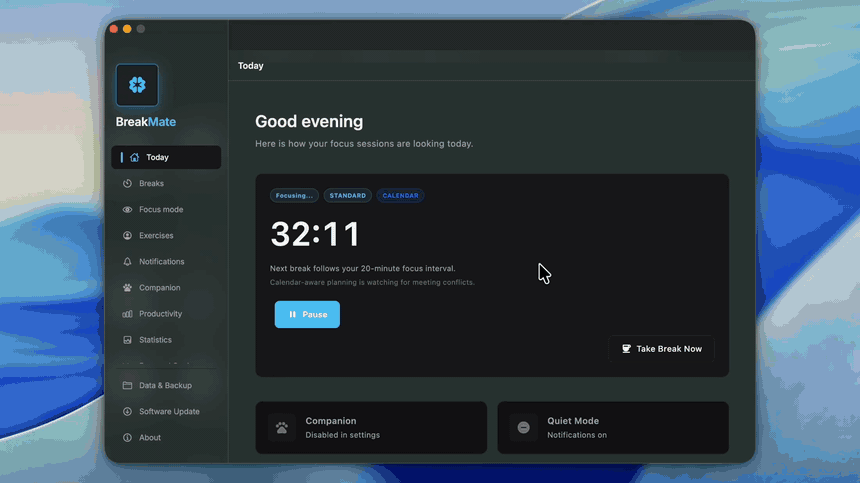
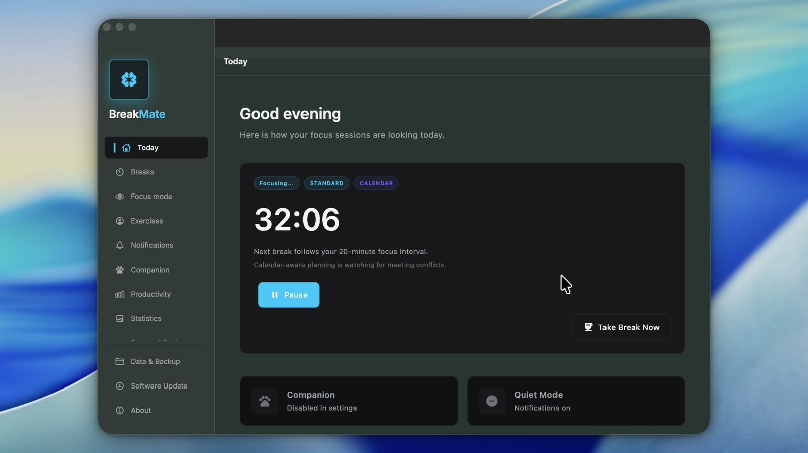
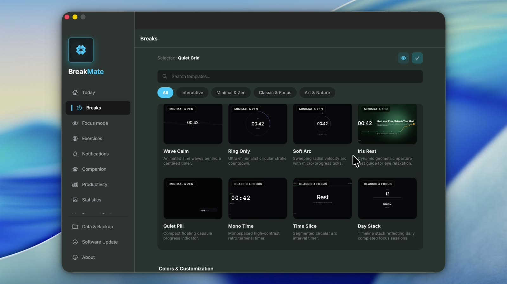
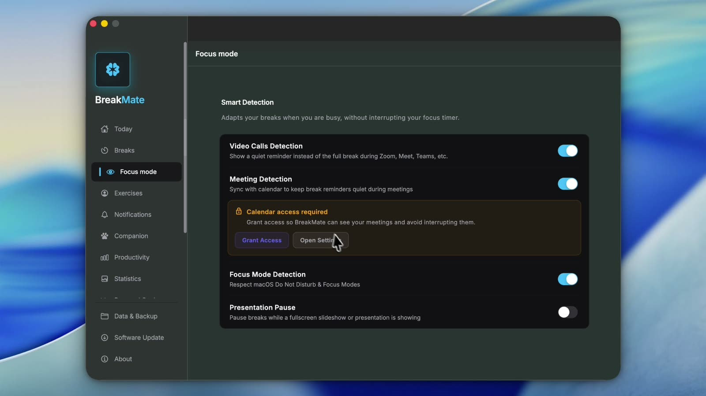
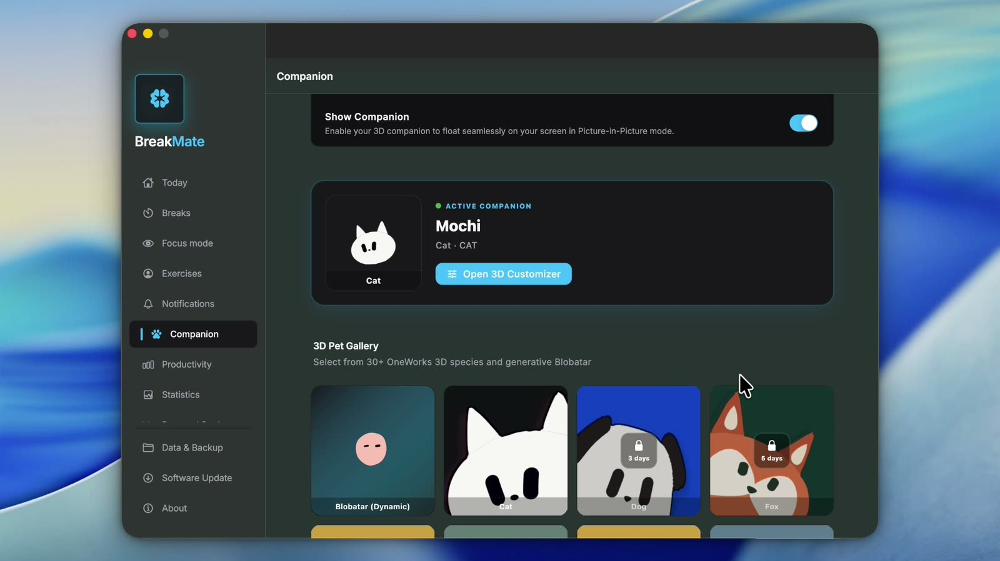
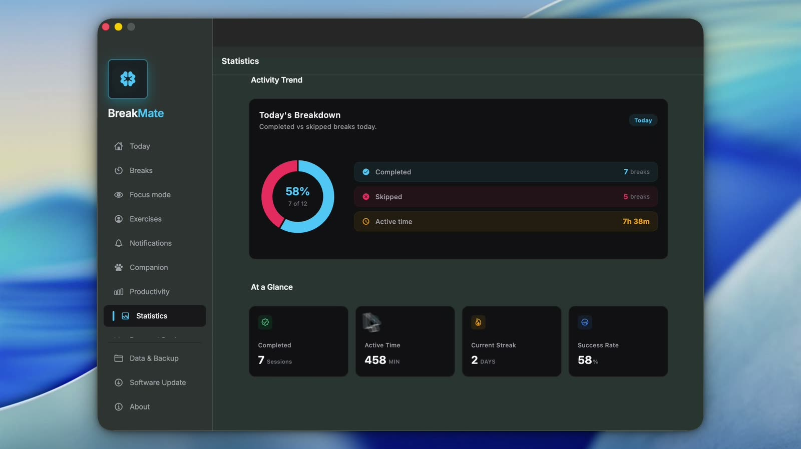
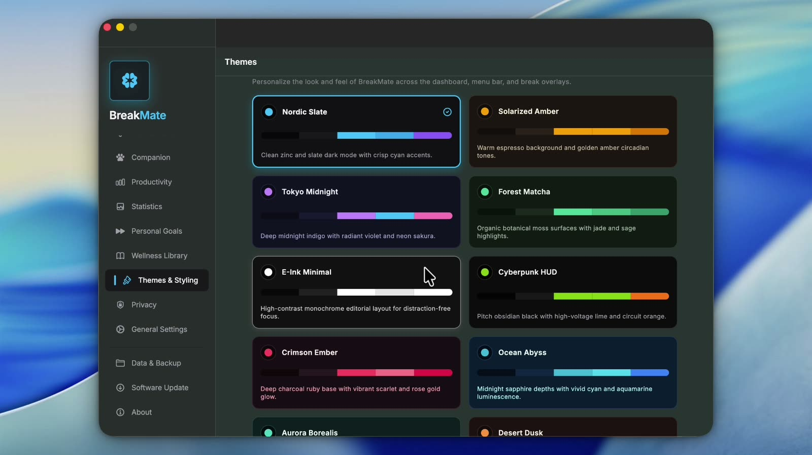
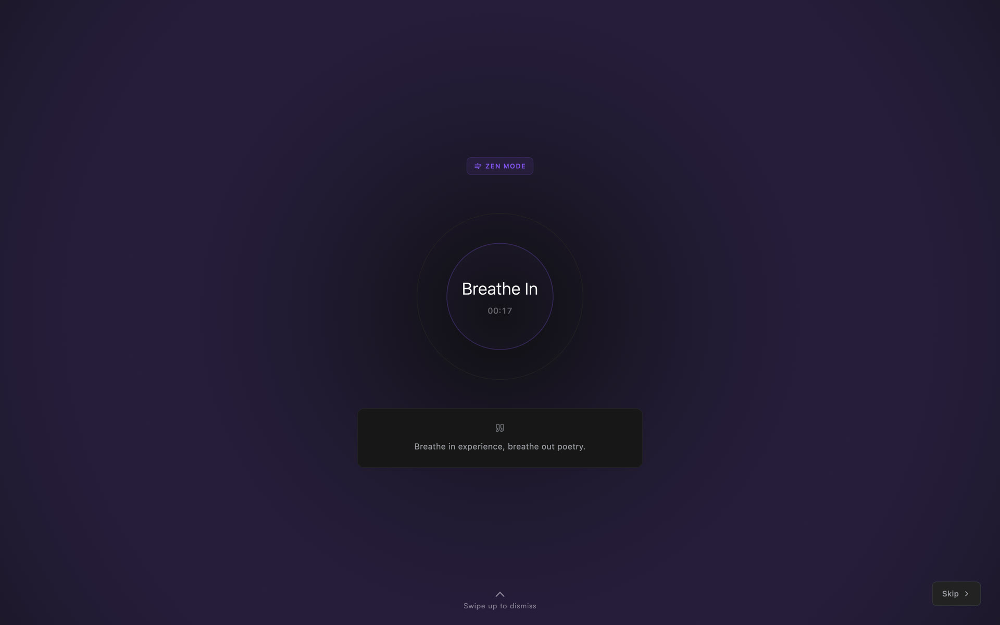

<div align="center">

# BreakMate

**A desktop break-reminder and wellness companion that protects your eyes, posture, and focus — without breaking your flow.**

[](CHANGELOG.md)
[](#installation)
[](https://flutter.dev)
[](LICENSE)

[Download](https://github.com/bijithpn/standup/releases) · [Features](#features) · [Getting Started](#development-setup) · [Architecture](#architecture) · [Changelog](CHANGELOG.md)

<a href="screenshots/walkthrough.mp4"></a>

</div>

---

## Table of Contents

- [Overview](#overview)
- [Screenshots](#screenshots)
- [Features](#features)
- [Installation](#installation)
- [Usage](#usage)
- [Privacy & Data](#privacy--data)
- [Development Setup](#development-setup)
- [Architecture](#architecture)
- [Testing & Quality](#testing--quality)
- [Release Pipeline](#release-pipeline)
- [Project Structure](#project-structure)
- [Documentation](#documentation)
- [Contributing](#contributing)
- [License](#license)

---

## Overview

Long stretches at a screen lead to eye strain, stiff necks, and "tunnel-vision" focus. BreakMate sits in your menu bar / system tray, schedules breaks around the way you actually work, and nudges you at the right moment — never during a meeting or presentation.

| Pillar | What BreakMate does |
| --- | --- |
| **Physical protection** | Eye-rest (20-20-20), stretch, and movement prompts with guided exercises. |
| **Mental clarity** | Pomodoro, Deep Work, Developer, and Health presets to prevent cognitive fatigue. |
| **Context awareness** | Detects meetings, presentations, idle time, and calendar events, and adapts. |
| **Ambient companion** | A customizable 3D/animated desktop pet that reflects your state and celebrates streaks. |
| **Insight** | Local-only analytics for breaks, focus, and app usage. |

## Screenshots

<p align="center">
  <a href="screenshots/walkthrough.mp4"></a><br>
  <sub>▶ <a href="screenshots/walkthrough.mp4"><b>Watch the 46-second walkthrough</b></a> (MP4)</sub>
</p>

| | |
| --- | --- |
| <br>**Today** — live countdown, next-break reasoning, quiet mode | <br>**Break templates** — searchable gallery with accent colors |
| <br>**Smart detection** — meetings, Focus mode, presentation pause | <br>**Companion** — 3D species, breeds, and streaks |
| <br>**Statistics** — productivity and wellness scores | <br>**Themes** — 12 curated presets plus auto light/dark |
| <br>**Zen Mode break** — paced breathing circle | <br>**Quiet Pill** — subtle reminder during meetings |

---

## Features

### Break orchestration

- **Short and long breaks** on independent intervals, driven by a precision `TimerEngine`.
- **Break profiles** — one-click presets:

  | Preset | Short break | Long break |
  | --- | --- | --- |
  | Health Mode | every 20 min · 20 s | every 60 min · 1 min |
  | Developer Mode | every 30 min · 30 s | every 90 min · 2 min |
  | Deep Work | every 50 min · 60 s | every 120 min · 3 min |
  | Pomodoro | every 25 min · 5 min | every 100 min · 15 min |

- **Pre-break warning** — a translucent countdown (20 s by default) with a visible timer and skip action, so you can finish your sentence first.
- **Flash notifications** — subtle screen-edge pulses for low-distraction awareness.
- **Strict mode** — prevents skipping; locks the break overlay above other windows.
- **Snooze and skip** from the tray, dashboard, or overlay.
- **Global hotkey** — `⌘⌥B` (macOS) / `Ctrl+Alt+B` (Windows/Linux) starts a break immediately, or skips the active one.
- **Adaptive scheduling** that learns from how often you skip or postpone breaks.
- **Clock-out flow** — a wind-down session and guided end-of-day reflection with a daily summary.

### Break overlay

- Full-screen overlay with multiple templates (including breathing, eye-sync, and Night Sky), animated posters, and per-template accent colors.
- Context line explaining *why* the break started and what is expected.
- Guided exercises with automatic posture and eye-rest prompts.
- 12 curated theme presets (e.g. Crimson Ember, Ocean Abyss, Aurora Borealis, Desert Dusk, Lavender Mist, Monokai Pro).
- Multi-monitor aware placement.

### Smart detection

- **Meetings** — auto-pauses during calls (Zoom, Teams, Meet, etc.) via native detection and browser URL matching; resumes when the call ends.
- **Calendar-aware scheduling** — reads your calendar (macOS EventKit bridge) and finds the next free gap long enough for a break instead of colliding with meetings.
- **Presentation pause** — defers breaks when a fullscreen slideshow or screen share covers the display; during meetings/presentations only a subtle low-opacity reminder is shown, never the full overlay.
- **Idle detection** — pauses or resets the cycle when you step away; away time can count as a break.
- **Contextual wellness** — suggestions tailored to the active app category (coding → posture, writing → wrist relief, browsing → eye rest, meetings → post-call reset).

### Desktop companion

- Customizable 3D avatars: shape, species, breed, colors, expressions, and a saved name.
- `PetBehaviorBrain` — a weighted-decision engine with personality traits (playfulness, curiosity, sociability), context awareness (cursor proximity, meetings), and a recency penalty to avoid repetitive animation.
- Draggable, resizable **Picture-in-Picture** window; optional **wandering** across the desktop.
- **Environment builder** — themes, parallax skies, dynamic ground, ambient lighting, particles, and background wildlife.
- Reacts to break/focus streak milestones (3 / 7 / 14 / 30 / 60 / 100 days).
- Low-distraction mode and a resource-saving optimization toggle.

### Analytics & insights

- **Break statistics** with a 365-day GitHub-style heatmap.
- **Productivity & focus** — activity segments, focus time by day, daily focus score, trends, and streaks.
- **App usage tracking** (opt-in) with category daily budgets and over-budget warnings.
- **Break/focus correlation** insights and a **weekly digest** with one-click export.
- **Personal goals** — daily focus targets, break-count targets, and sitting limits.
- **Wellness library** — browse, favorite, hide, and rotate exercises by category.

### Menu bar / system tray

- Live countdown in several styles, plus companion, minimal, default, or countdown-only icons.
- Quick actions: start/skip break, 5- and 15-minute snooze, quiet mode, companion toggle, and pause reason.

### Platform & reliability

- Launch at startup, single-instance protection, automatic crash reporting (Sentry, release builds only), and in-app auto-updates via Sparkle on macOS.
- Settings search, per-section reset, and inline dependency warnings.

---

## Installation

Download the latest build from the [**Releases**](https://github.com/bijithpn/standup/releases) page.

| Platform | Package | Notes |
| --- | --- | --- |
| **macOS** 12+ | `.dmg` | Drag to Applications. Updates automatically via Sparkle. |
| **Windows** | Installer (`BreakMate-Setup-<version>`) | Inno Setup installer. |
| **Linux** | Release archive | Includes a `.desktop` entry (`com.bijith.breakmate.desktop`). |

**macOS permissions** — BreakMate may ask for Calendar access (to avoid scheduling breaks over meetings) and Accessibility/Screen-related access for meeting, idle, and app-usage detection. Every feature degrades gracefully if you decline.

---

## Usage

1. Launch BreakMate; the onboarding flow lets you pick a break profile.
2. The app lives in the menu bar / system tray. Click it for the countdown and quick actions.
3. Open the dashboard to adjust **General, Breaks, Focus mode, Exercises, Notifications, Clock Out, Companion,** and **Statistics**.
4. Press the global hotkey any time to take a break right now.

---

## Privacy & Data

- **Local-first.** Break history, focus data, and app usage are stored on your device (ObjectBox).
- **App usage tracking is opt-in** and can be disabled or wiped at any time from Settings → Privacy.
- A built-in **Privacy Report** lists which signals are detected, what is stored, and which permissions are used.
- Crash reporting (Sentry) runs only in production builds with a configured DSN; the dev flavor does not report.

---

## Development Setup

### Prerequisites

| Tool | Version / notes |
| --- | --- |
| Flutter | `3.41.x` (Dart `^3.10.4`) |
| macOS | Xcode + CocoaPods |
| Windows | Visual Studio 2022 with "Desktop development with C++" |
| Linux | GTK 3 toolchain (`clang`, `cmake`, `ninja-build`, `libgtk-3-dev`) |
| Release tooling (optional) | `create-dmg`, `gh`, Sparkle tools — see [Release Pipeline](#release-pipeline) |

### Run locally

```bash
git clone https://github.com/bijithpn/standup.git
cd standup
flutter pub get

# macOS only
cd macos && pod install && cd ..
```

BreakMate has `dev` and `prod` flavors. macOS uses Xcode flavors; Windows/Linux receive the flavor via `FLUTTER_FLAVOR` because Flutter has no `--flavor` support there.

```bash
# macOS
flutter run -d macos -t lib/main_dev.dart  --flavor dev
flutter run -d macos -t lib/main_prod.dart --flavor prod

# Windows
flutter run -d windows -t lib/main_dev.dart  --dart-define=FLUTTER_FLAVOR=dev
flutter run -d windows -t lib/main_prod.dart --dart-define=FLUTTER_FLAVOR=prod

# Linux
flutter run -d linux -t lib/main_dev.dart --dart-define=FLUTTER_FLAVOR=dev
```

Equivalent launch configurations are in `.vscode/launch.json`.

### Code generation

ObjectBox, Freezed, and JSON models are generated. Re-run after changing annotated models:

```bash
dart run build_runner build --delete-conflicting-outputs
```

### Verify native changes

`flutter analyze` only checks Dart. After touching `macos/`, `windows/`, or `linux/`, do a real build:

```bash
flutter build macos   --debug --flavor dev -t lib/main_dev.dart
flutter build windows --debug -t lib/main_dev.dart --dart-define=FLUTTER_FLAVOR=dev
flutter build linux   --debug -t lib/main_dev.dart --dart-define=FLUTTER_FLAVOR=dev
```

---

## Architecture

BreakMate runs several Flutter engines (via `FlutterEngineGroup`) so heavy secondary UI never blocks the dashboard.

| Isolate / engine | Responsibility |
| --- | --- |
| **Main** | Dashboard, settings, timer engine, statistics, native hooks. |
| **Overlay** (`overlayMain`) | Full-screen break, warning, and reminder overlays. |
| **Companion** (`companionMain`) | 3D avatar web renderer for the desktop pet and PiP window. |
| **Background polling** | Lightweight activity, meeting, and app-usage sampling. |

- **IPC** — a MethodChannel layer syncs timer state, meeting/sleep state, and interactions across isolates in real time.
- **Native bridges** — Swift (`AppDelegate`, `CompanionWindowManager`, EventKit calendar) on macOS; C++ (`display_bridge`, `companion_window_manager`) on Windows; GTK runner on Linux.
- **Single-instance lock** — a localhost TCP listener (port `10425` for production, `10426` for the dev flavor, so the two can run side by side); a second launch of the same flavor asks the running instance to shut down, with stale-process cleanup.
- **Storage** — unified `StorageService` with migrations, lock-file cleanup, and a mirrored key-value store for critical settings.
- **State & DI** — `provider` + `get_it`, with a dedicated bootstrapper for startup ordering.

See [`docs/architecture.md`](docs/architecture.md) for the full write-up.

---

## Testing & Quality

```bash
flutter analyze   # static analysis
flutter test      # unit, widget, and property-based tests (glados, mocktail, fake_async)
```

Manual macOS/Windows smoke checks are documented in [`docs/dev-checks.md`](docs/dev-checks.md). CI runs on every push via `.github/workflows/cross_platform_ci.yml`.

---

## Release Pipeline

Releases are automated through GitHub Actions:

1. **`macos_release.yml`** — builds, signs (Sparkle Ed25519), packages the DMG, publishes the GitHub release, and updates `appcast.xml`.
2. **`desktop_release.yml`** — after the macOS release succeeds, builds and attaches the Linux and Windows artifacts to the same release.

Local release helpers live in `scripts/`:

| Script | Purpose |
| --- | --- |
| `generate_sparkle_keys.sh` | One-time Ed25519 key setup for Sparkle auto-updates. |
| `create_dmg.sh` | Full local pipeline: build → DMG → sign → GitHub release → appcast. |
| `publish_release.sh` | Sign an already-built DMG and patch `appcast.xml`. |

```bash
cp .env.example .env.release          # then edit values
./scripts/create_dmg.sh --version 1.8.1 --build 38 --notes "What changed"
```

Useful flags: `--skip-build`, `--skip-github`, `--dry-run`. Never commit your Sparkle private key. Full walkthrough: [`docs/release_guide.md`](docs/release_guide.md).

---

## Project Structure

```text
lib/
├── app/            # App shell, bootstrapper, dependency injection
├── core/           # Services (timer, storage, IPC, native), config, utilities
├── features/
│   ├── break_system/   break_overlay/   clock_out/
│   ├── companion/      analytics/       wellness/
│   ├── dashboard/      settings/        themes/
│   └── menu_bar/       onboarding/
├── shared/         # Shared theme, widgets, utilities
├── main_dev.dart / main_prod.dart      # Flavor entry points
macos/  windows/  linux/                # Native runners and bridges
scripts/  docs/  test/  screenshots/
```

---

## Documentation

| Document | Contents |
| --- | --- |
| [`CHANGELOG.md`](CHANGELOG.md) | Version history and release notes |
| [`docs/architecture.md`](docs/architecture.md) | Isolates, engines, and responsibilities |
| [`docs/release_guide.md`](docs/release_guide.md) | Sparkle keys, signing, and release steps |
| [`docs/dev-checks.md`](docs/dev-checks.md) | Manual smoke checks per platform |
| [`docs/project-audit.md`](docs/project-audit.md) | Codebase audit and findings |

---

## Contributing

Contributions are welcome.

1. Fork the repo and create a branch from `dev`.
2. Make your change; run `flutter analyze` and `flutter test`.
3. Build the affected native platform if you touched native code.
4. Open a pull request against `dev` describing the change and any user-facing impact.

Please report bugs via [GitHub Issues](https://github.com/bijithpn/standup/issues) with your OS, app version, and reproduction steps.

---

## License

Released under the [MIT License](LICENSE).

Developed by **Bijith P N**.
