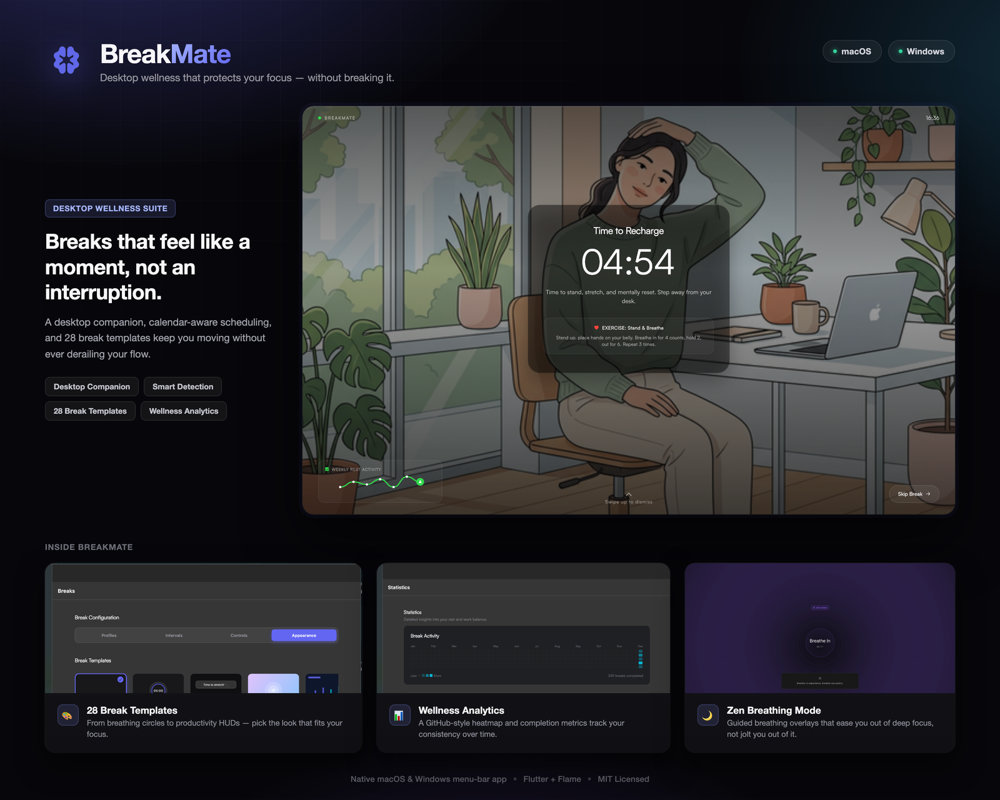

# BreakMate

> A high-performance, multi-engine macOS & Windows productivity suite designed to protect your physical and mental well-being.
>
> **Developed by Bijith P N**

BreakMate is a sophisticated wellness platform that integrates deeply with your desktop environment. By utilizing multiple Flutter engines, a custom behavior AI for ambient feedback, and native platform hooks, BreakMate ensures that your work-life balance is actively managed without disrupting your creative flow.


> Looking for the project roadmap or an architecture deep-dive instead of a product README? See [`BREAKMATE_ROADMAP.md`](BREAKMATE_ROADMAP.md) and [`Architecture_Audit.md`](Architecture_Audit.md).

## 🖥️ Application Showcase



---

## 🎯 Scope & Purpose

Modern computing often leads to "flow-state tunnel vision," where users ignore the physical costs of prolonged sitting and screen time. BreakMate's scope is to bridge the gap between intent and action. It provides:

1. **Physical Protection**: Through enforced eye-rest, stretching, and movement prompts.
2. **Mental Clarity**: By utilizing Pomodoro and Deep Work cycles to prevent cognitive fatigue.
3. **Ambient Awareness**: Using a non-intrusive desktop pet to reflect app state and encourage a more relaxed workspace.

---

## ✨ Features in Depth

### 🕒 Intelligent Break Orchestration

- **The Engine**: A high-precision `TimerEngine` manages the transition between states. It calculates focus quality based on how often you skip or postpone breaks.
- **Strict Mode**: When enabled, the app uses a `screenSaver` window level on macOS and a top-most overlay on Windows, effectively locking the workstation for the duration of the break.
- **Pre-Break Warning**: A translucent 20-second countdown overlay appears before breaks, allowing you to gracefully finish your last sentence or commit your code.
- **Flash Notifications**: Subtle, non-intrusive screen-edge pulse cues rendered via a high-performance overlay to keep you aware of upcoming breaks without breaking your flow.

### 🧠 Smart Detection (The "Silent" Feature)

- **Zero-Touch Pausing**: Using native EventChannels, the app detects if you are in a meeting (Zoom, Teams, etc.) and auto-pauses the timer. It resumes only when the call ends.
- **Idle Intelligence**: If you walk away from your desk for more than 5 minutes, BreakMate detects the inactivity via the native bridge and automatically resets or pauses the work cycle.

### 🐈 Pet Behavior Engine (The AI Brain)

The desktop pet (cat/dog) isn't just a static animation; it's driven by `PetBehaviorBrain`, an AI decision engine:

- **Weighted Decision Making**: Uses a weighted scoring algorithm to choose the next behavior based on context.
- **Context Awareness**: If the cursor is nearby, the pet enters an `interacting` or `curious` state. If a meeting is detected, it enters a `quiet` or `sleep` state.
- **Personality Matrix**: Each pet profile has unique traits like `playfulness`, `curiosity`, and `sociability`.
- **Recency Penalty**: Prevents the pet from repeating the same animation twice in a row, making it feel more "alive."

### 🌎 Interactive Environment Builder & PiP

- **Custom Habitats**: Build a rich 2D environment for your companion with customizable themes, parallax skies, and dynamic ground layers.
- **Live Preview**: See changes in real-time as you switch themes and decorations.
- **Ambient Elements**: Dynamic lighting, atmospheric particles, and background animals (like flying birds) bring the companion's world to life.
- **Interactive PiP Overlay**: A high-performance, draggable Picture-in-Picture window lets your pet roam freely across your desktop without disrupting your workflow.

### 📈 Analytics & Wellness Insights

- **Heatmaps**: A GitHub-style activity graph tracking your focus consistency over a 365-day window.
- **Productivity Score**: A proprietary algorithm that weights completed breaks vs. skipped ones against your daily goal.
- **Wellness Library**: A curated collection of articles and exercises designed by ergonomic experts.

---

## 🖥️ Platform Bridges

### macOS (Swift)

- **`AppDelegate.swift`**: Handles `FlutterEngineGroup` management and MethodChannel routing.
- **`CompanionWindowManager.swift`**: Creates a custom `NSPanel` for the draggable pet.

### Windows (C++)

- **`display_bridge.cpp`**: Low-level Win32 calls to manage multi-monitor overlay placement.
- **`companion_window_manager.cpp`**: Implements layered windows for pet animations.

---

## 🛠️ Local Development Setup

To run BreakMate locally for development, follow these steps. BreakMate targets **macOS** and **Windows** — most of Local Development is shared, with platform-specific notes called out below.

### 📋 Prerequisites

- **Flutter SDK**: `^3.10.4` (see the `environment.sdk` constraint in `pubspec.yaml`).
- **macOS**: Xcode (for the toolchain and Simulator/device signing) and CocoaPods — run `pod install` inside `macos/` to fetch native dependencies.
- **Windows**: Visual Studio 2022 with the "Desktop development with C++" workload (required for `flutter build windows`).
- **Node.js**: Only needed if you plan to build DMGs locally (`npm install -g appdmg`) — see [Scripts Reference](#-scripts-reference).

### ⚙️ Quick Start

1. **Clone and Install Dependencies**:

   ```bash
   flutter pub get

   # macOS only — fetch native CocoaPods dependencies
   cd macos && pod install && cd ..
   ```

2. **Configure Environment Variables**:
   Copy `.env.example` to create your active `.env` configuration:

   ```bash
   cp .env.example .env
   ```

3. **Run the Application**:
   BreakMate supports `prod` and `dev` configurations. The macOS runner uses
   Xcode flavors, while the Windows runner receives the configuration through
   `FLUTTER_FLAVOR` because Flutter does not support `--flavor` for Windows
   desktop builds:

   ```bash
   # Windows — Dev configuration
   flutter run -d windows -t lib/main_dev.dart --dart-define=FLUTTER_FLAVOR=dev

   # Windows — Production configuration
   flutter run -d windows -t lib/main_prod.dart --dart-define=FLUTTER_FLAVOR=prod

   # macOS — Dev configuration
   flutter run -d macos -t lib/main_dev.dart --flavor dev

   # macOS — Production configuration
   flutter run -d macos -t lib/main_prod.dart --flavor prod
   ```

   Equivalent platform-specific launch configurations are included in
   `.vscode/launch.json`.

4. **Run the Test Suite**:

   ```bash
   flutter analyze   # static analysis — should report no issues
   flutter test      # full unit + widget + property test suite
   ```

5. **Verify a Native Change Compiles** (only if you touched `macos/` or `windows/` code):

   `flutter analyze` does **not** compile Swift or C++ — it only checks Dart. Native-side changes need a real build to catch registration/linker errors:

   ```bash
   flutter build macos --debug --flavor dev -t lib/main_dev.dart
   flutter build windows --debug -t lib/main_dev.dart --dart-define=FLUTTER_FLAVOR=dev
   ```

---

## 🔬 Core System Internals & Lifecycles

### 🔒 Single-Instance Lock

To prevent database locking issues and process conflicts, BreakMate restricts execution to a single main process:

- On startup, the main app binds a TCP listener to localhost port `10425`.
- If the port is already in use, the new instance contacts the running process to trigger a graceful shutdown.
- If the running process is stale or locked, the app automatically executes a native force-termination command (`lsof`/`kill -9`) to clean up the port and boot cleanly.

### 🔌 Multi-Engine Isolate Structure

BreakMate runs three separate isolates utilizing `FlutterEngineGroup` to isolate memory and run secondary screens at 60fps:

- **`mainIsolate`**: Runs the dashboard UI, handles preferences, settings, and native background hooks.
- **`overlayMain`** (`@pragma('vm:entry-point')`): Runs the fullscreen break overlays.
- **`companionMain`** (`@pragma('vm:entry-point')`): Runs the low-overhead Flame engine animating your pet companion.
- **IPC Synchronisation**: A specialized MethodChannel layer translates events (like meeting activity, timers, sleep state, and mouse interactions) across the isolates in real-time.

---

## 🚀 Release & Deployment Pipeline

BreakMate includes a fully automated release pipeline for building, packaging, signing, and deploying updates via Sparkle and GitHub Releases. All variables are dynamically configured via environment files.

For a detailed step-by-step walkthrough on generating keys, config setups, and troubleshooting build releases, see the [Release & Sparkle Key Management Guide](docs/release_guide.md).

### ⚙️ Configuration (`.env`)

The pipeline reads its options from `.env` at the project root. Copy `.env.example` to get started:

```bash
cp .env.example .env
```

Adjust the variables inside:

- **`APP_NAME`**: Set your application name (e.g. `BreakMate`).
- **`RELEASE_GITHUB_REPO`**: GitHub repository where DMG releases are created and hosted.
- **`APPCAST_GITHUB_REPO`**: GitHub repository hosting the Sparkle update XML (`appcast.xml`).
- **`GIT_BRANCH`**: Branch to commit and push changes of `appcast.xml` to (default: `main`).

---

## 🔧 Scripts Reference

All four release-tooling files live in `scripts/`. They're macOS-only (Sparkle + DMG distribution is a macOS-specific update mechanism) — Windows builds are distributed separately and don't use this pipeline.

| Script | Purpose | Run it when... |
| --- | --- | --- |
| [`generate_sparkle_keys.sh`](#-sparkle-key-management-generate_sparkle_keyssh) | One-time Ed25519 keypair setup | Setting up Sparkle auto-updates for the first time |
| [`create_dmg.sh`](#-build--release-create_dmgsh) | Full release pipeline (build → DMG → sign → GitHub release → appcast) | Cutting a new release from a clean local build |
| [`publish_release.sh`](#-standalone-signing-publish_releasesh) | Signs an **already-built** DMG and patches `appcast.xml` | You already have a DMG (e.g. from CI) and just need to sign + publish it |
| `appdmg.json` | Config consumed by `create_dmg.sh` (background image, icon layout, window size for the installer window) | Not run directly — edit it to change how the installer window looks |

---

### 🔑 Sparkle Key Management (`generate_sparkle_keys.sh`)

For secure automatic updates, Sparkle requires Ed25519 signatures. Run this script once to initialize your keys:

```bash
./scripts/generate_sparkle_keys.sh
```

- **What it does**:
  1. Generates an Ed25519 keypair.
  2. Exports the private key securely to `~/secrets/breakmate_sparkle_private.pem` (never commit this!).
  3. Auto-patches `macos/Runner/Info.plist` with the public key (`SUPublicEDKey`).

---

### 📦 Build & Release (`create_dmg.sh`)

The main entry point for creating a new release. One command runs the entire pipeline:

```bash
./scripts/create_dmg.sh --version 1.2.0 --build 26 --notes "Optimized companion animations and updated window layout."

# Or point to a release-notes file instead of an inline string:
./scripts/create_dmg.sh --version 1.2.0 --build 26 --notes-file release_notes.md
```

**Requirements:** `flutter` in `PATH`, `create-dmg` and `gh` CLI from Homebrew (`brew install create-dmg gh` — then `gh auth login`), and a Sparkle private key (from `generate_sparkle_keys.sh`) either at `~/secrets/breakmate_sparkle_private.pem` or via `export SPARKLE_PRIVATE_KEY=/path/to/key.pem`.

#### Pipeline Steps

1. **Flutter Build**: Builds the macOS target in release mode using your configured flavor.
2. **DMG Packaging**: Uses `appdmg` to package the app into a premium Installer DMG (configured via `scripts/appdmg.json`).
3. **Sign update**: Extracts the file size and signs the DMG with your Ed25519 key.
4. **GitHub Release**: Deletes any pre-existing release/tag of the same version, creates a new GitHub release, uploads the DMG, and attaches your release notes.
5. **Appcast Updates**: Surgically inserts or updates the version item inside `appcast.xml` using an inline Python processor.
6. **Git Commit & Push**: Commits `appcast.xml` changes and pushes to your configured `GIT_BRANCH`.

#### Useful Flags

| Flag | Effect |
| --- | --- |
| `--skip-build` | Skip the `flutter build` step and reuse the existing build output — useful for retrying a failed publish step without rebuilding. |
| `--skip-github` | Sign the DMG and update `appcast.xml`, but don't create a GitHub release — useful for a dry run of the signing/appcast steps. |
| `--dry-run` | Preview the entire pipeline without touching any local or remote assets. |

---

### 🔏 Standalone Signing (`publish_release.sh`)

For when you already have a built DMG (e.g. produced by CI, or built by hand) and just need to sign it and publish the update metadata — without re-running a full Flutter build:

```bash
./scripts/publish_release.sh \
    --dmg /path/to/BreakMate-Installer.dmg \
    --version 1.2.0 \
    --build 26 \
    --notes "What changed in this release" \
    --push
```

- **What it does**: locates the Sparkle `sign_update` tool automatically, signs the DMG with your Ed25519 key (from macOS Keychain or a key file via `--private-key`), computes the real file size, and patches `appcast.xml` — updating the matching version's `sparkle:edSignature`/length, or inserting a new `<item>` if that version isn't in the appcast yet.
- **Config**: reads from `.env.release` at the project root (same shape as `.env` — copy `.env.example` to `.env.release` if you haven't already).
- **Flags**: `--private-key <path>` to use a specific key file instead of Keychain, `--account <name>` for a named Keychain account, `--push` to commit and push `appcast.xml` afterward, `--dry-run` to preview without writing anything.

---

## 📜 License

MIT License - See the `LICENSE` file for details.

---
